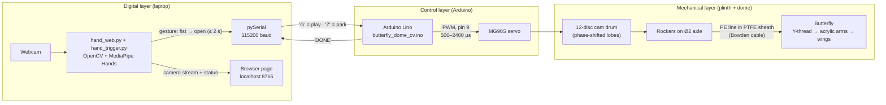

# Butterfly Dome — System Overview

A kinetic sculpture inspired by Iris van Herpen. Seven translucent butterflies sit on a 3D-printed hemisphere and open and close their wings in a travelling wave. One servo hidden in the plinth drives all of them. The physical trigger is a hand gesture: the computer's webcam watches for a **fist → open palm** gesture, and that starts one flapping cycle.

Author: Yuwen Wang

---

## 1. System at a glance



| Layer | What it does | Main parts |
|---|---|---|
| **Sensing** | Detects the hand gesture | Webcam, MediaPipe Hands (21 landmarks) |
| **Decision** | Turns the gesture into a single trigger event | `hand_trigger.py` gesture logic, run by `hand_web.py` (state machine) |
| **Interface** | Shows the camera, the instructions and the status | `web/index.html` in the browser |
| **Communication** | Sends commands over USB serial | pySerial ↔ Arduino Serial, 115200 baud |
| **Actuation** | Plays one eased 0°→180°→0° sweep | Arduino Uno + MG90S servo |
| **Transmission** | Splits one rotation into 7 timed wing pulls | Cam drum → rockers → Bowden lines |
| **Expression** | Wings close about 60° and reopen by gravity | Polyester wings, tape hinge, acrylic stiffener |

---

## 2. Interaction flow

```mermaid
sequenceDiagram
    participant U as Visitor
    participant PC as hand_web.py
    participant A as Arduino
    participant S as Servo / Cams
    participant B as Butterflies

    U->>PC: Makes a fist
    PC->>PC: State = FIST_SEEN (start 2 s window)
    U->>PC: Opens the palm (within 2 s)
    PC->>A: 'G'
    PC->>PC: Lock (ignore gestures while playing); page releases on-screen butterflies
    A->>S: Eased sweep 0° → 180° → 0°
    S->>B: Cam lobes pass the rockers in sequence
    B-->>U: Wave of wings: #1 → #2 → #3 → #4, mediums interleaved
    A->>PC: "DONE"
    PC->>PC: Unlock and wait for the next gesture
```

**Gesture logic (`hand_trigger.py`, reused by `hand_web.py`)**
- A finger counts as *extended* when its tip is more than 1.15× as far from the wrist as its middle (PIP) joint. The thumb counts when its tip is far from the index knuckle.
- The pose must hold for 4 frames before it counts, which filters out flicker.
- **Fist** = 0–1 fingers extended. **Open** = 4–5 fingers extended.
- Trigger = a fist, then an open palm within 2 s. The script then waits for `DONE` before it accepts another gesture, so a cycle cannot be interrupted.

**Serial protocol**

| Direction | Message | Meaning |
|---|---|---|
| PC → Arduino | `G` | Play one full cycle |
| PC → Arduino | `Z` | Park the servo at 0° (wings open) |
| Arduino → PC | `DONE` | Cycle finished, ready for the next one |

---

## 3. Digital part

### 3.1 Software files

| File | Runs on | Role |
|---|---|---|
| `01_Code/Arduino/butterfly_dome_cv/butterfly_dome_cv.ino` | Arduino | **Main show program.** Waits for `G`, plays one cycle, replies `DONE`. |
| `01_Code/Python/web/hand_web.py` | Laptop | **Used in the final piece.** Local web server: webcam + gesture detection, sends `G`, streams the camera to the page. |
| `01_Code/Python/web/index.html` | Browser | **Used in the final piece.** Gesture control page: live camera, instructions, status, on-screen butterfly animation. |
| `01_Code/Python/hand_trigger.py` | Laptop | Gesture detection (settings + finger counting). Also runs on its own as a desktop OpenCV window. |
| `01_Code/Arduino/butterfly_dome/butterfly_dome.ino` | Arduino | Stand-alone loop with no computer: sweep → pause → repeat |
| `01_Code/Arduino/servo_zero/` | Arduino | Moves the servo to 0° before you seat the cam drum |
| `01_Code/Arduino/servo_sweep_test/` | Arduino | Checks the servo's direction and range |
| `01_Code/Arduino/butterfly_v2/` + `hand_v2.py` | — | Redesign concept (not built) |

### 3.2 Key Arduino parameters

| Parameter | Value | Note |
|---|---|---|
| `SERVO_PIN` | 9 | PWM signal |
| `US_MIN` / `US_MAX` | 500 / 2400 µs | Swap the two values if the servo turns the wrong way |
| `SWEEP_MS` | 4000 | Duration of one 0→180° pass; this sets the flapping speed |
| `PAUSE_MS` | 1500 | Rest between passes (stand-alone mode only) |
| Easing | cosine ease-in-out | Gentle start and stop, so the wings don't jerk |

### 3.3 Dependencies

```
Python 3.9–3.12
opencv-python
mediapipe==0.10.14
pyserial
Arduino IDE + Servo.h
```

### 3.4 How to run

1. Upload `butterfly_dome_cv.ino` to the Arduino.
2. Close the Arduino Serial Monitor, because only one program can use the port at a time.
3. Run `pip install -r 01_Code/Python/requirements.txt`.
4. Run `python 01_Code/Python/web/hand_web.py`. The script finds the Arduino by itself; if it doesn't, give the port: `python hand_web.py COM3` (Windows) or `python hand_web.py /dev/cu.usbmodem…` (Mac).
5. Open **http://localhost:8765** and click **Turn on camera**.
6. Make a fist, then open your hand. One wave of flapping plays.

Without the browser: `python 01_Code/Python/hand_trigger.py` does the same in a desktop camera window (press `q` to quit).

---

## 4. Electronics

```
Laptop ──USB (data + power)── Arduino Uno
                                 D9  ── servo signal (orange)
                                 5V  ── servo + (red)
                                 GND ── servo − (brown)
          (optional 470–1000 µF electrolytic capacitor across 5V / GND, stripe on GND)
```

- One MG90S runs directly from the Arduino's 5 V pin. This is how the piece is wired.
- The capacitor is optional. It smooths the servo's current spikes, which can otherwise reset the Arduino.
- If you later use several servos (the plug-in module idea), give them their own 5 V supply of at least 2 A and **connect its ground to the Arduino GND**.

---

## 5. Mechanical system

### 5.1 Structure

| Part | Spec | Material / process |
|---|---|---|
| Plinth | Ø150 × 50 mm, 3 mm top plate | PLA, FDM (Bambu H2D) |
| Dome | Hemisphere R75, 2.5 mm wall, with guide sleeves | PLA, FDM |
| Cam drum | 12 discs, base circle R10.5, on the servo horn | PLA |
| Rockers | First-class levers, 14 mm in / 32 mm out, on a Ø2 metal rod | PLA |
| Sliders | Glued fixed into the sleeves (flap-only build) | PLA |
| Butterfly bodies | L150 / S75 / S53, with a slanted line hole | PLA |
| Wings | 0.18 mm polyester film | Laser cut |
| Wing stiffeners | 1/16" (1.6 mm) acrylic, min web 2.5 mm | Laser cut |
| Lines / sheaths | PE fishing line inside PTFE tubes | Off the shelf |

### 5.2 Single-butterfly force path

```
Servo turns
  → cam lobe lifts the rocker's short nose
  → long rocker tip drops 6.3 mm (large) / 3.15 mm (medium)
  → line slides down inside the PTFE sheath
       (the sheath is butted between the top-plate seat and the slider fitting
        and carries the compression, so the butterfly itself is not pulled down)
  → body slanted hole → Y-thread (2 × 8 cm branches)
  → pulls both acrylic arms down past the tape hinge
  → wings close ≈ 60°

Cam returns to its base circle
  → tip rises, line slackens
  → wings reopen by their own weight + tape springback (no springs)
```

See `04_Diagrams/F3_module_section.png` and `04_Diagrams/F8_rocker_line.png`.

### 5.3 As-built channel map (4 large + 3 medium, flap only)

| Rocker | Butterfly | Size | Stroke | Flap window (servo °) |
|---|---|---|---|---|
| 1 | — (empty) | | | |
| 2 | #1 | Large | 6.3 mm | 35–85 |
| 3 | filler | | | |
| 4 | #2 | Large | 6.3 mm | 63–113 |
| 5 | filler | | | |
| 6 | #3 | Large | 6.3 mm | 91–141 |
| 7 | filler | | | |
| 8 | #4 | Large | 6.3 mm | 122–172 |
| 9 | #5 + #7 | Medium | 3.15 mm | Small-A cam: 14–40, 74–100, 134–160 |
| 10 | #6 | Medium | 3.15 mm | Small-B cam: 44–70, 104–130 |
| 11 | filler | | | |
| 12 | — (empty) | | | |

The large windows overlap, so the four large butterflies close one after another as a travelling wave. The mediums flutter in between. The full 12-butterfly design table is in `02_CAD/v1_as_built/line_table.txt`.

### 5.4 Setup rule

- At **servo 0°**, every cam shows its base circle, so every rocker tip is at its highest point (about 8 mm below the top plate).
- Tie each line at the rocker tip in this state, leaving **≈ 0.5 mm slack**.
- If nothing moves during a sweep, the servo is turning the wrong way. Swap `US_MIN`/`US_MAX`, or re-seat the drum at 180°.

---

## 6. Fabrication files

| Folder | Contents |
|---|---|
| `02_CAD/v1_as_built` | STEP / STL / 3MF for the plinth, dome, drum, rockers, bodies and repair parts, plus the line table |
| `02_CAD/v2_simplified_redesign` | Concept with one servo and a 2-tier spool (not built) |
| `02_CAD/source_scripts` | Parametric CadQuery / Python sources |
| `03_LaserCut` | Wings (polyester) and stiffeners (acrylic) as AI / PDF / SVG / DXF |
| `04_Diagrams` | Mechanism, assembly and wiring figures |

---

## 7. Known limits and next steps

- **Tape hinge** is the wear point. A laser-cut living hinge or a film hinge would last longer.
- **Line tension** is set by hand. A small turnbuckle at the rocker tip would make tuning repeatable.
- **Gesture → one fixed cycle.** `hand_v2.py` already has a FOLLOW mode, where the opening of the hand maps continuously onto the wing angle (v2 hardware).
- **Plug-in micro-servo modules** (one servo per butterfly) would remove the lines entirely and make each butterfly independently addressable. This was explored as a concept.

---

*Tools: Arduino, Python (OpenCV, MediaPipe, pySerial), CadQuery, Bambu Studio, Illustrator/laser cutter. Parts of the code and CAD scripts were developed with the help of Claude (Anthropic).*
